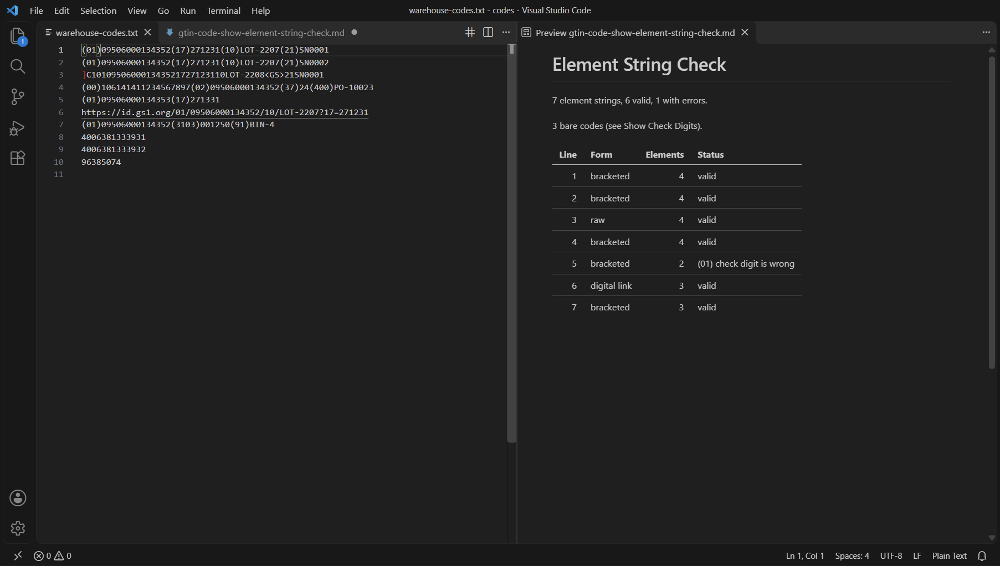
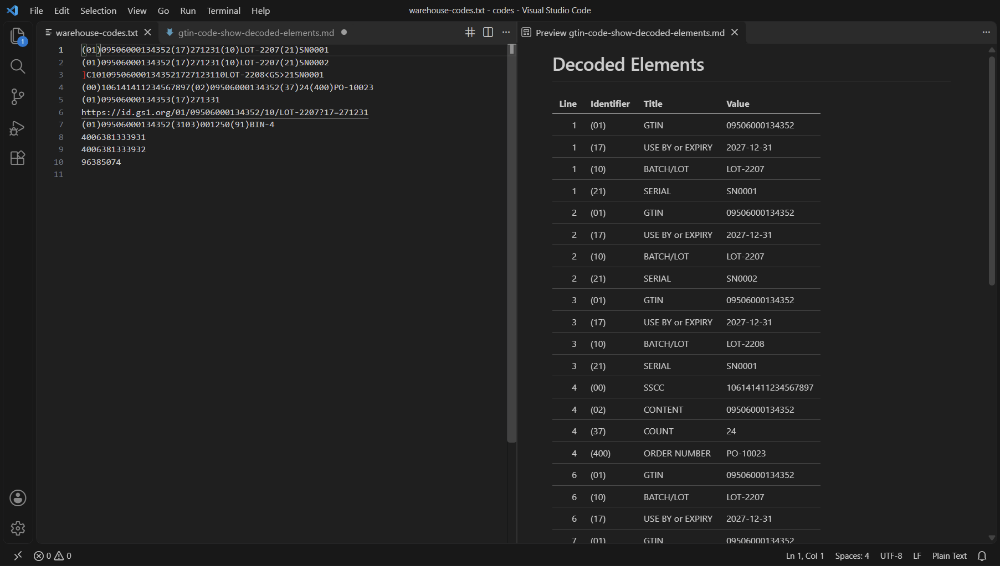
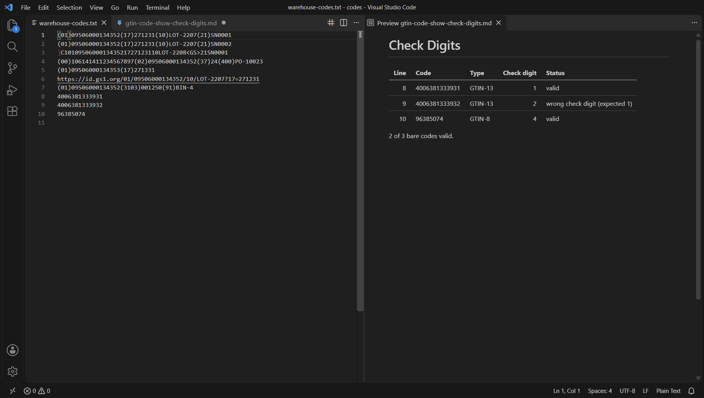
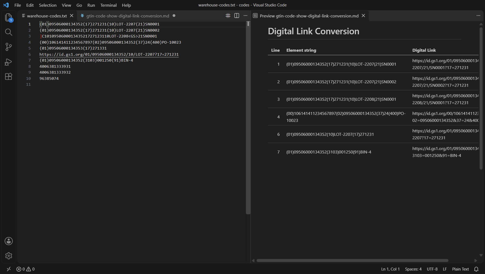
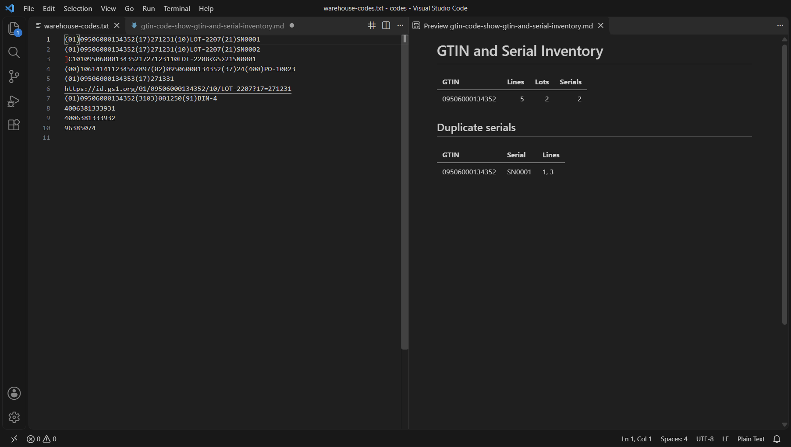

# GTIN Code Atlas

GTIN Code Atlas reads lists of GS1 element strings, scanned barcode data and GS1 Digital Links, one per line, and turns them into clear Markdown reports: which strings are valid and why the others are not, every element decoded with its title, dates and weights in plain form, the check digits of bare GTIN and SSCC numbers, the GS1 Digital Link web address for each element string, and an inventory of lots and serial numbers per GTIN with duplicate serials.

Everything runs on your computer. There is no telemetry. The only network request the extension ever makes is the licence check for the optional Pro tier (see [Privacy](PRIVACY.md)).

## What it does

* **Show Element String Check**: Every element string checked against the GS1 identifier table: form, number of elements and the first problem found.
* **Show Decoded Elements**: Every element of the valid strings with its identifier, title and value in plain form.
* **Show Check Digits**: Bare GTIN-8, GTIN-12, GTIN-13, GTIN-14 and SSCC numbers with their check digits.
* **Show Digital Link Conversion** (Pro): The GS1 Digital Link web address for each valid element string.
* **Show GTIN And Serial Inventory** (Pro): Lots and serial numbers per GTIN, and serial numbers that appear more than once.

## Free, trial and Pro

| Feature | Free | Pro |
| --- | :---: | :---: |
| Show Element String Check | yes | yes |
| Show Decoded Elements | yes | yes |
| Show Check Digits | yes | yes |
| Show Digital Link Conversion |  | yes |
| Show GTIN And Serial Inventory |  | yes |
| Open Sample File, walkthrough, Report A Problem | yes | yes |

The free reports need no key, no account and no network connection, and they will not be moved behind the licence key later. The first Pro command starts a **free 14-day trial** on this computer. After that, Pro is a one-time purchase, not a subscription: **Pro Personal USD 19** (one person, use at work allowed) or **Pro Business USD 39 per user** (one key per user of an organisation). A key works on up to 3 computers. The checkout page shows the final price and any taxes for your country. Licence keys are sold by Dodo Payments, the merchant of record. Details: [licence](docs/licence.md), [terms](TERMS.md).

## Commands

Open the Command Palette and type `GTIN Code Atlas`.

| Command | Tier |
| --- | :---: |
| GTIN Code Atlas: Show Element String Check | Free |
| GTIN Code Atlas: Show Decoded Elements | Free |
| GTIN Code Atlas: Show Check Digits | Free |
| GTIN Code Atlas: Show Digital Link Conversion | Pro |
| GTIN Code Atlas: Show GTIN And Serial Inventory | Pro |
| GTIN Code Atlas: Open Sample File | Free |
| GTIN Code Atlas: Open Walkthrough | Free |
| GTIN Code Atlas: Show Documentation | Free |
| GTIN Code Atlas: Report A Problem | Free |
| GTIN Code Atlas: Buy Pro | Free |
| GTIN Code Atlas: Enter Licence Key | Free |
| GTIN Code Atlas: Show Licence Status | Free |
| GTIN Code Atlas: Remove Licence From This Machine | Free |

## Settings

| Setting | Default | Meaning |
| --- | --- | --- |
| `gtinCodeAtlas.maxFileSizeMB` | 50 | Largest file a report reads (0.1 to 50 MB; VS Code passes files only up to 50 MB to extensions). |
| `gtinCodeAtlas.openReportsAsPreview` | true | Open each report in the Markdown preview as well. |

## FAQ

**Does GTIN Code Atlas send my codes anywhere?**
No. Every report is created on your computer from the text in the editor, and nothing is sent to GS1 or any other service.

**Which identifiers are known?**
All Application Identifiers of the GS1 Barcode Syntax Dictionary (more than 500), with their formats, predefined lengths, check digits and date rules, so raw scanner data is split exactly where GS1 says it ends.

**Does it tell me whether a GTIN is registered?**
No. It checks the structure, check digit and dates of a code. Whether a brand owner has assigned a GTIN can only be checked with GS1's registry services.

**What is a GS1 Digital Link?**
A web address that carries the same data as a barcode, such as https://id.gs1.org/01/09506000134352/10/LOT-2207. The Pro report builds it from each element string, with the primary key, qualifiers in GS1 order and the other data as query parameters, and lists elements that a Digital Link cannot carry.

## For IT and procurement

* Publisher: SmallStepsStudio (Visual Studio Marketplace), smallstepsstudio (Open VSX).
* Network: one host, `live.dodopayments.com`, for the licence check only, and only after a key is entered. No telemetry. The trial uses no network.
* Files are read from the editor only; the extension writes no files and changes none.
* Source: <https://github.com/small-steps-studio/gtin-code-atlas>.
* Licence agreement: [LICENSE.txt](LICENSE.txt). Terms: [TERMS.md](TERMS.md). Privacy: [PRIVACY.md](PRIVACY.md).

## Support

Run **GTIN Code Atlas: Report A Problem** or open an issue at <https://github.com/small-steps-studio/gtin-code-atlas/issues>. Never post a licence key or confidential data in a public issue.

GS1 is a registered trademark of GS1 AISBL; GTIN Code Atlas is an independent product and is not affiliated with or endorsed by GS1. The identifier table is based on the GS1 Barcode Syntax Dictionary (Apache License 2.0).
